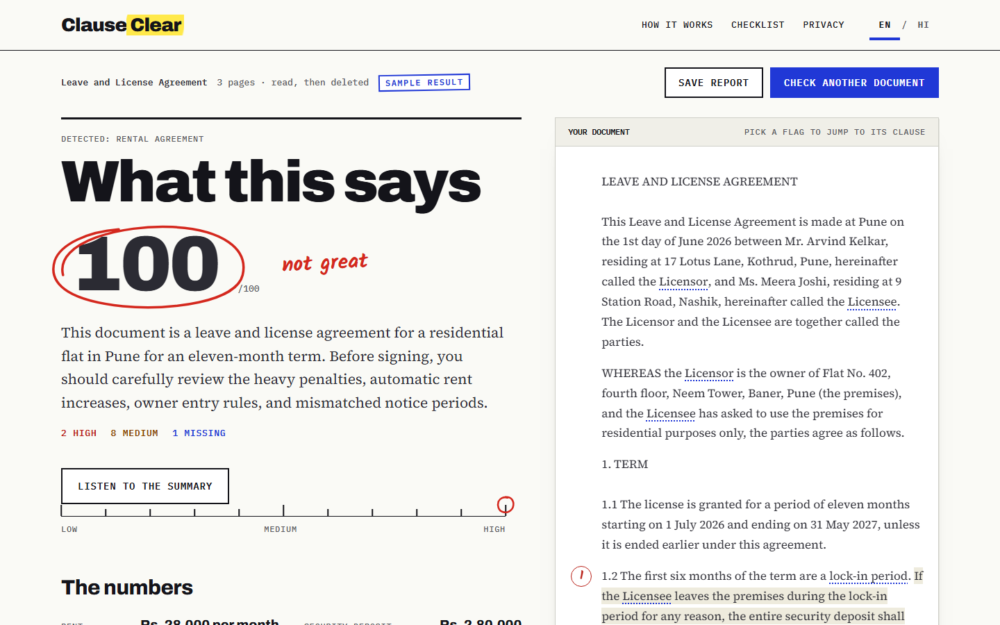
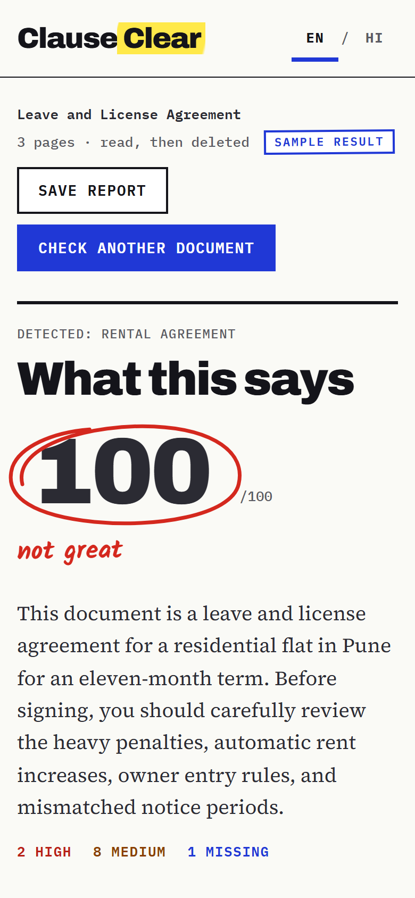
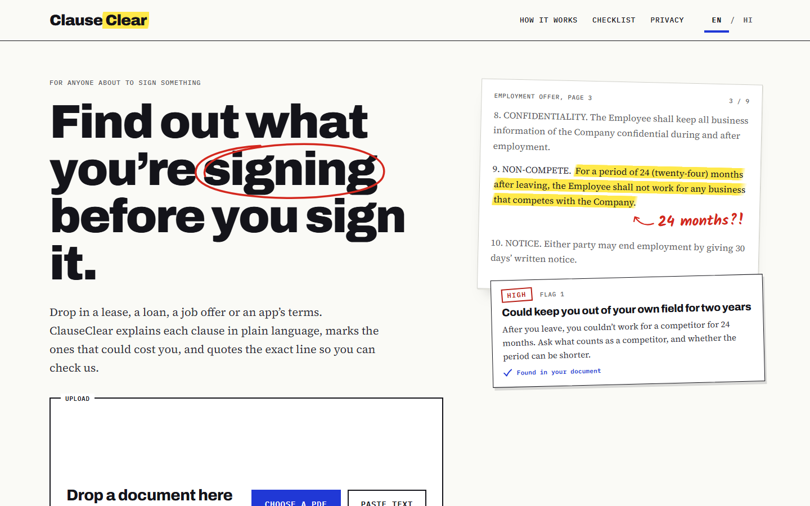
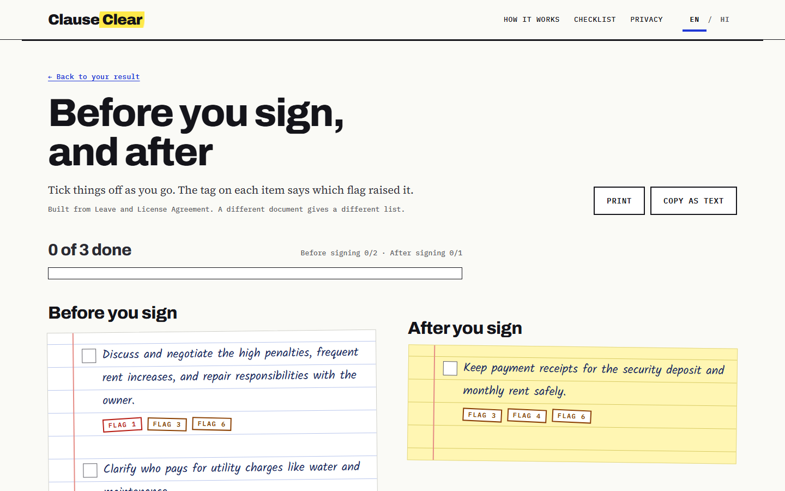
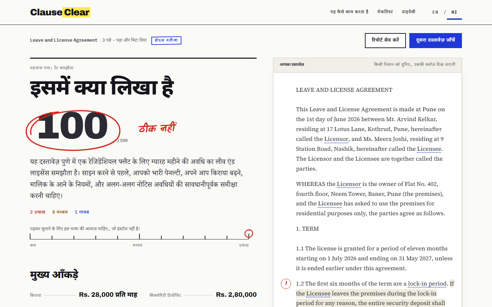
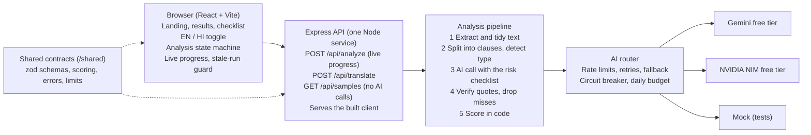

# ClauseClear

**Find out what you're signing before you sign it.**

ClauseClear reads a legal document (a lease, a job offer, a loan agreement, an app's terms of service) and explains it in plain language. It marks the clauses that could cost you, says why, lists what the document should say but doesn't, gives you questions to ask and a checklist for before and after you sign. Every red flag quotes the exact line from your document, and ClauseClear checks that the line is really there before it shows you the flag. Results are available in English and Hindi.

It is for first-time renters, graduates with their first job offer, and anyone about to click "I agree".

Informational only. Not legal advice.

## Screenshots

| Results (desktop)                                                                                                                                                   | Results (phone)                                                     |
| ------------------------------------------------------------------------------------------------------------------------------------------------------------------- | ------------------------------------------------------------------- |
|  |  |

| Landing page                                                          | Checklist                                                                                                                 | Results in Hindi                                                                                         |
| --------------------------------------------------------------------- | ------------------------------------------------------------------------------------------------------------------------- | -------------------------------------------------------------------------------------------------------- |
|  |  |  |

All five come from the bundled samples (`npm run screenshots`).

## Features

- **Upload a PDF or paste text.** PDFs up to 10 MB and 25 pages with a text layer; pasted text from 200 to 60,000 characters.
- **Document type detection.** Rental, employment, loan and terms of service get a detailed checklist; everything else gets a general reading. "Not right? Change it" re-runs the analysis with the type you choose.
- **Live progress** from the server (reading, finding clauses, checking risks, verifying quotes), with Cancel.
- **Summary and a risk score** from 0 to 100 with a band (low, medium, high). The score is computed in code from the flags, never by the model.
- **Key facts** such as rent, deposit and notice period, each checked against the document's own numbers.
- **Ranked red flags**: high, then medium, then missing. Each has a plain explanation, why it matters, and the quoted line marked "Found in your document". Select a flag and the document scrolls to the clause and highlights it (a side panel on desktop, a bottom sheet on phones). Filter by severity.
- **Missing clauses**: things the document should state but doesn't.
- **Every clause in plain language**, in order.
- **Questions to ask**, each with a copy button, and Copy all.
- **A before-and-after-signing checklist** built from the flags, with tick boxes and progress.
- **Glossary tooltips** on legal terms found in the document.
- **English and Hindi.** The page is English until you choose Hindi. Quotes and the document always stay in the original English.
- **Read aloud** (where the browser has a voice for the language), and **save or print** a clean report.
- **Three samples** (rental, job offer, loan) that load instantly with no AI calls.
- **Works on phones** from 320 px wide, with the keyboard alone, and with screen readers.

## How it works

1. **Read.** The server reads the text from your PDF (or takes the pasted text), tidies it, and splits it into numbered clauses, so each line has an address such as `s12`.
2. **Recognise the type.** Keywords decide whether it is a lease, a job offer, a loan or terms of service. If they can't tell, one small AI call does.
3. **Ask the AI.** The AI gets the clauses and a checklist of risks for that type of document, and is told to cite the clause and copy the exact words for every problem it finds. Your document is marked as data, so instructions hidden inside it are not followed.
4. **Check every quote (the verified-quote method).** This is the step that makes ClauseClear trustworthy. For each red flag, the server looks up the clause the AI pointed to and checks that the quoted words are really in it. A quote that is almost right (a typo, a changed quote mark) is replaced with the real words from your document; a quote that can't be found is dropped, along with its flag. Numbers in the key facts must appear in your document too. If more than half the flags fail, the AI is asked once more with stricter rules, and if that still fails you are told. So every flag you see points to a line you can read for yourself.
5. **Score in code.** The score comes from a fixed formula over the verified flags: 18 points per high-risk flag, 8 per medium, 10 per missing high-risk item and 5 per missing medium item, capped at 100. The AI never gives a score.
6. **Translate on request.** Choosing Hindi sends only the explanations, questions and checklist for translation, never the quotes. Every number in a translation is checked against the English; one that doesn't match stays in English.

Nothing is stored: the document is read, answered and deleted from the server, and the result lives only in your browser tab.

## Architecture



The API and the website come from the same origin, so there is no cross-origin traffic: on Vercel the website is served by the CDN and the API by one function running the Express app; on a Node host, `npm start` serves both. The server is stateless: no database, no files written, no accounts.

## Setup from a clean clone

You need Node 24 (`.node-version` pins 24.18.0) and git.

```bash
git clone https://github.com/SurabhiD2008/ClauseClear.git
cd ClauseClear
npm ci
cp .env.example .env
npm run check:providers
npm run build
npm start
```

Then open http://localhost:3000. On Windows PowerShell, use `copy .env.example .env` for the fourth line.

Before `npm run check:providers`, put your free keys in `.env`:

1. **Gemini.** Sign in at [Google AI Studio](https://aistudio.google.com), choose **Get API key**, and create a key. Paste it as `GEMINI_API_KEY`. In AI Studio's model list, pick a model your free tier can use and copy its ID into `GEMINI_MODEL` (this build was tested with `gemini-3.6-flash`; leave `GEMINI_THINKING_LEVEL` empty for Gemini 2.x models).
2. **NVIDIA.** Sign in at [build.nvidia.com](https://build.nvidia.com), open an instruct model, and choose **Get API Key**. Paste it as `NVIDIA_API_KEY`, and copy the model's ID into `NVIDIA_MODEL` (tested with `google/gemma-4-31b-it`).

`npm run check:providers` lists the models each key can see and sends one tiny request to each configured provider (one call each), so you know the keys work before you start. It never prints a key. One working provider is enough; the other is the fallback.

No keys? Set `LLM_PROVIDER_ORDER=mock` in `.env`. The samples are real, and uploads get made-up analyses from the mock, which is useful for trying the interface. `npm start` refuses to start if no provider is configured and the mode is not `mock`, and it logs which providers are active (names and models, never keys). `npm start` and `check:providers` read `.env` themselves; values already set in the environment take precedence.

## Environment variables

Copy `.env.example` to `.env`. Only the keys and model IDs are required; everything else has a default kept below the free limits.

| Variable                   | Default                                            | What it does                                                                                  |
| -------------------------- | -------------------------------------------------- | --------------------------------------------------------------------------------------------- |
| `LLM_PROVIDER_ORDER`       | `gemini,nvidia`                                    | Providers tried in order; `mock` for a demo or tests                                          |
| `GEMINI_API_KEY`           |                                                    | Gemini key from Google AI Studio (server only)                                                |
| `GEMINI_MODEL`             |                                                    | Gemini model ID from AI Studio                                                                |
| `GEMINI_THINKING_LEVEL`    | `LOW`                                              | Gemini 3 and later: `MINIMAL`, `LOW`, `MEDIUM` or `HIGH`; empty for Gemini 2.x                |
| `GEMINI_RPM`               | `8`                                                | Gemini requests per minute                                                                    |
| `GEMINI_RPD_BUDGET`        | `200`                                              | Gemini requests per day before falling back                                                   |
| `GEMINI_BASE_URL`          | `https://generativelanguage.googleapis.com/v1beta` | Change only if Google moves the API version                                                   |
| `NVIDIA_API_KEY`           |                                                    | NVIDIA key from build.nvidia.com (server only)                                                |
| `NVIDIA_MODEL`             |                                                    | NVIDIA instruct model ID                                                                      |
| `NVIDIA_BASE_URL`          | `https://integrate.api.nvidia.com/v1`              | NVIDIA's OpenAI-compatible endpoint                                                           |
| `NVIDIA_RPM`               | `20`                                               | NVIDIA requests per minute                                                                    |
| `NVIDIA_RPD_BUDGET`        | `200`                                              | NVIDIA requests per day before falling back                                                   |
| `NVIDIA_MAX_OUTPUT_TOKENS` | `3072`                                             | Largest answer NVIDIA is asked for; larger jobs are split                                     |
| `MAX_INPUT_TOKENS`         | `24000`                                            | Largest input per call (characters / 4); longer documents are read in parts                   |
| `LLM_CONCURRENCY`          | `2`                                                | AI calls in flight across the whole server                                                    |
| `LLM_TIMEOUT_MS`           | `45000`                                            | Time limit per AI call                                                                        |
| `ANALYSIS_BUDGET_MS`       | `100000`                                           | Time limit for one whole analysis                                                             |
| `IP_ANALYSES_PER_10_MIN`   | `6`                                                | Analyses per visitor (IP address) per 10 minutes                                              |
| `GLOBAL_ANALYSES_PER_DAY`  | `60`                                               | Analyses across the whole server per day                                                      |
| `TRUST_PROXY`              | `0`                                                | Proxy hops whose `X-Forwarded-For` is trusted for the per-IP limit (`1` on Vercel and Render) |
| `PORT`                     | `3000`                                             | Port the server listens on (hosts set it)                                                     |
| `SMOKE_URL`                | `http://localhost:3000`                            | Default URL for `npm run smoke`                                                               |
| `MOCK_SCENARIO`            | `normal`                                           | Which made-up answer the mock gives (tests)                                                   |

Any other OpenAI-compatible free endpoint works without code changes: add its name to `LLM_PROVIDER_ORDER` and set `<NAME>_API_KEY`, `<NAME>_MODEL` and `<NAME>_BASE_URL`.

## Commands

| Command                   | What it does                                                                                                                                     |
| ------------------------- | ------------------------------------------------------------------------------------------------------------------------------------------------ |
| `npm run dev`             | Server and client in watch mode (client on Vite's dev server, API on port 3000)                                                                  |
| `npm run build`           | Production build: shared, server (`server/dist`) and client (`client/dist`)                                                                      |
| `npm start`               | The production server: API and website on one port                                                                                               |
| `npm run typecheck`       | TypeScript in strict mode across all workspaces                                                                                                  |
| `npm run lint`            | ESLint and Prettier                                                                                                                              |
| `npm run test`            | Unit and API tests (Vitest, Supertest), mock provider only, no network                                                                           |
| `npm run e2e`             | Playwright on five screen sizes, with a guard that fails a test on any console error, failed request, layout overflow or accessibility violation |
| `npm run audit`           | The full gate (below); writes a report to `audit/report.json` and `AUDIT.md`                                                                     |
| `npm run results:check`   | Checks every sample and fixture result: quotes, references, score, counts, Hindi numbers                                                         |
| `npm run check:providers` | Lists models per key and sends one tiny request to each provider (real calls)                                                                    |
| `npm run test:live`       | Three real PDFs through the real providers, at most 6 calls; manual, never in the audit                                                          |
| `npm run smoke -- <url>`  | Checks a running instance, local or deployed (below)                                                                                             |
| `npm run screenshots`     | Saves the five screenshots above into `docs/screenshots` from sample data                                                                        |

`npm run e2e` and `npm run screenshots` need Playwright's Chromium once: `npx playwright install chromium`.

## Tests and audit

Tests never call a real AI service and never need keys: they use a mock provider with scripted scenarios (normal, made-up quotes, rate limits, timeouts, broken JSON, slow answers and more).

`npm run audit` runs typecheck, lint, unit and API tests, the production build, the end-to-end suite on five screen sizes (desktop, laptop, tablet, phone, small phone), a secret scan of the source and the built files, `npm audit`, and a bundle-size budget, then prints one pass or fail line per step.

## Free-tier limits, and how the app respects them

ClauseClear runs on free API keys, so it is careful with calls:

- **Few calls per analysis.** A sample costs 0 calls. A typical document costs 1 call; a document whose type is unclear costs 1 more; a long document is read in parts plus one short summary call. Switching to Hindi costs 1 to 3 calls (samples: none).
- **Limits below the free tiers.** Each provider has its own requests-per-minute and daily budget, set lower than the free limits, and at most 2 AI calls run at once across the whole server; the rest wait in a queue.
- **Fallback.** If a provider says no (rate limited, an error, a timeout or an unreadable answer), the next provider in `LLM_PROVIDER_ORDER` is tried. Retries back off 2, 4 and 8 seconds. A provider that fails 3 times in a row is paused for 60 seconds.
- **Fair use.** Each visitor can run 6 analyses per 10 minutes, and the server 60 per day (both configurable).
- **When everything is busy**, you get a clear message and the samples, which never need the AI.
- These counters live in memory: they reset when the server restarts.

## Deploy

### Vercel (recommended)

`vercel.json` sets everything up: Vercel installs with `npm ci`, runs `npm run build`, serves the website from `client/dist` on its CDN, and runs the API as one Node function (`api/index.js`) that every `/api/*` request goes to. The function is the same Express app as `npm start`, so the API, its limits and its security headers are the same; `vercel.json` adds the same security headers to the website's pages and long caching to its hashed files.

1. Push the repository to GitHub.
2. In Vercel, choose **Add New > Project** and import the repository. Leave the framework preset as **Other** and the build settings as they are; `vercel.json` provides them.
3. Under **Environment Variables**, add:

| Name                    | Value                                                                                        |
| ----------------------- | -------------------------------------------------------------------------------------------- |
| `LLM_PROVIDER_ORDER`    | `gemini,nvidia`                                                                              |
| `GEMINI_API_KEY`        | your Google AI Studio key                                                                    |
| `GEMINI_MODEL`          | your Gemini model ID, e.g. `gemini-3.6-flash`                                                |
| `GEMINI_THINKING_LEVEL` | `LOW` (leave it out for Gemini 2.x models)                                                   |
| `NVIDIA_API_KEY`        | your build.nvidia.com key                                                                    |
| `NVIDIA_MODEL`          | your NVIDIA model ID, e.g. `google/gemma-4-31b-it`                                           |
| `TRUST_PROXY`           | `1` (Vercel puts the visitor's address in `X-Forwarded-For`; the per-visitor limit needs it) |

4. Click **Deploy**. When it is live, run `npm run smoke -- https://<your-project>.vercel.app`.

Things to know on Vercel:

- **Node 24.** Vercel picks the Node version from `engines` in `package.json` (24.x). If the project settings show another version, set **Settings > General > Node.js Version** to 24.x.
- **Long analyses.** `vercel.json` gives the function up to 120 seconds (an analysis is capped at 100). That needs Fluid compute, which is on by default for new projects; if a deploy says the duration is too long, turn it on under **Settings > Functions**.
- **Uploads up to 4.5 MB.** Vercel refuses request bodies over 4.5 MB before they reach the app, so on Vercel the PDF limit is 4.5 MB instead of 10 MB, and a larger file gets the "file is too large" message. Text PDFs of 25 pages are almost always far smaller; for a bigger file, paste the text.
- **Limits per instance.** Rate-limit counters and the daily budget are kept in memory, and Vercel may run more than one instance of the function, so each instance counts on its own. They reset when an instance is replaced.
- **Cold start.** The website is always on, because the CDN serves it. The first API request after a quiet spell starts the function, which takes a few seconds; the smoke check before a demo warms it.
- **Missing keys.** If no provider is configured (and the mode is not `mock`), the function refuses to start and every `/api` request fails; the function log says which variables are missing.

### Render, Railway or Fly (one Node server)

ClauseClear also runs as a single long-lived Node web service: build `npm ci --include=dev && npm run build`, start `npm start` (API and website on one port), health check `/api/health`, and the same variables as above. Do not set `PORT`; the host does.

- **Render.** `render.yaml` is a Blueprint for one free web service: **New > Blueprint**, pick the repository, and enter the variables when asked. Render's free plan sleeps after 15 minutes without traffic and takes about a minute to wake, during which the page does not load; open it or run the smoke check a few minutes before anyone uses it.
- **Railway.** Create a project from the repository; Railway reads `.node-version` and runs `npm run build` and `npm start`. Add the variables, set the health check path, and generate a domain. Railway's edge may add more than one proxy hop, so check the per-visitor limit before settling `TRUST_PROXY`.
- **Fly.** `fly launch` writes a Dockerfile and `fly.toml`. Build with dev dependencies, start with `npm start`, keep `internal_port = 3000`, add an HTTP check on `/api/health`, and set the keys with `fly secrets set`.

### Smoke check

```bash
npm run smoke -- https://<your-project>.vercel.app
npm run smoke -- https://<your-project>.vercel.app --analyze
```

Without `--analyze` it makes no AI call: it checks `/api/health`, the landing page and one of its scripts (compression and caching), a sample page, and `/api/samples/rental`. `--analyze` also runs one short analysis (about one or two AI calls) and checks that every quote is in its clause. The first request may take up to 120 seconds (a sleeping host waking up), and the time is printed. It exits with code 1 if anything fails.

## Privacy and limitations

- **Your document is not stored.** It is read, answered and deleted from the server. Results live only in your browser tab; reloading loses them. Logs record counts, timings and error codes, never document text, quotes or keys.
- **But its text is sent to an AI service.** Free AI tiers may use what they receive to improve their models. Redact names, addresses and ID numbers before you upload, and use the samples for demos.
- **No scanned documents.** PDFs need a text layer; a scan or photo is refused with a message offering paste text instead. Encrypted PDFs are refused too.
- **English documents only.** Text in Devanagari is refused; the explanations can then be shown in Hindi.
- **Limits:** PDFs up to 10 MB and 25 pages; text from 200 to 60,000 characters.
- **Not legal advice.** ClauseClear helps you read and ask better questions. It can miss things, and a flag is a prompt to ask, not a ruling. For anything high-risk, talk to a lawyer.

## Project structure

```text
ClauseClear/
  README.md  vercel.json  render.yaml  .env.example
  api/index.js       Vercel function entry (the Express app)
  shared/src/        zod schemas, scoring, error codes, limits, i18n key types
  server/src/
    app.ts  index.ts  start.ts  startup.ts  staticAssets.ts
    routes/          analyze, translate, samples, health
    llm/             router, rate limiter, Gemini and OpenAI-compatible adapters, mock
    pipeline/        extract (PDF worker), normalise, segment, detect type, prompts, verify, score
    checklists/      rental, employment, loan, terms, general
  client/src/
    routes/          landing, results, sample results, checklist, not found
    components/ state/ i18n/ (en.json, hi.json) styles/ lib/
  client/e2e/        Playwright specs and the oddity guard
  fixtures/          docs/ (test PDFs), samples/ (precomputed English and Hindi results)
  scripts/           audit, smoke, screenshots, check-providers, results check, live test
  docs/screenshots/  the screenshots above
```

## Credits

**Libraries:** [React](https://react.dev), [React Router](https://reactrouter.com), [Vite](https://vite.dev), [TypeScript](https://www.typescriptlang.org), [Express](https://expressjs.com), [zod](https://zod.dev), [pdf.js](https://mozilla.github.io/pdf.js/) (`pdfjs-dist`), [multer](https://github.com/expressjs/multer), [helmet](https://helmetjs.github.io), [express-rate-limit](https://github.com/express-rate-limit/express-rate-limit), [pino](https://getpino.io); for testing and tooling [Vitest](https://vitest.dev), [Supertest](https://github.com/ladjs/supertest), [Playwright](https://playwright.dev), [axe-core](https://github.com/dequelabs/axe-core), [pdf-lib](https://pdf-lib.js.org), [ESLint](https://eslint.org), [Prettier](https://prettier.io), [tsx](https://tsx.is) and [concurrently](https://github.com/open-cli-tools/concurrently).

**Fonts** (all under the SIL Open Font License, self-hosted through [Fontsource](https://fontsource.org)): [Archivo](https://fonts.google.com/specimen/Archivo) (headings), [Source Serif 4](https://fonts.google.com/specimen/Source+Serif+4) (body and document), [IBM Plex Mono](https://fonts.google.com/specimen/IBM+Plex+Mono) (labels), [Kalam](https://fonts.google.com/specimen/Kalam) (handwritten notes), and [Noto Sans Devanagari](https://fonts.google.com/noto/specimen/Noto+Sans+Devanagari) and [Noto Serif Devanagari](https://fonts.google.com/noto/specimen/Noto+Serif+Devanagari) (Hindi, loaded only when you choose Hindi).

**AI:** Google Gemini and NVIDIA NIM free tiers.

Made by Surabhi Datta.
